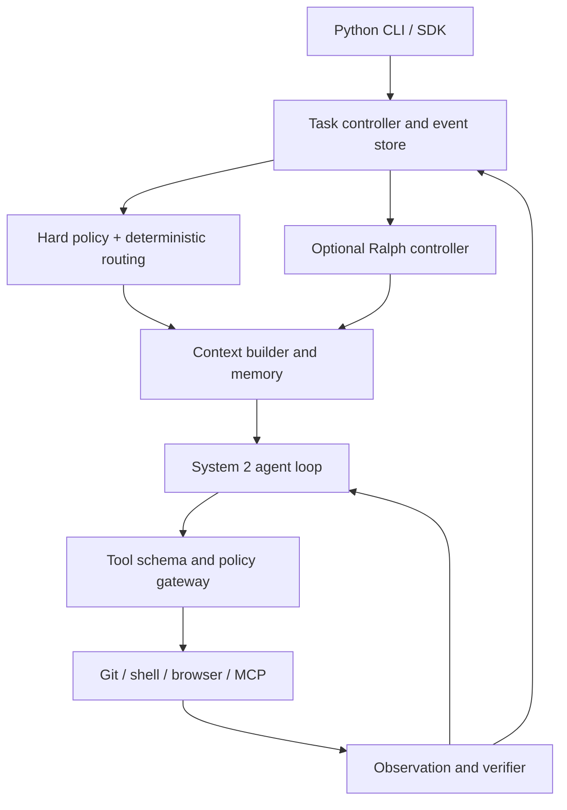
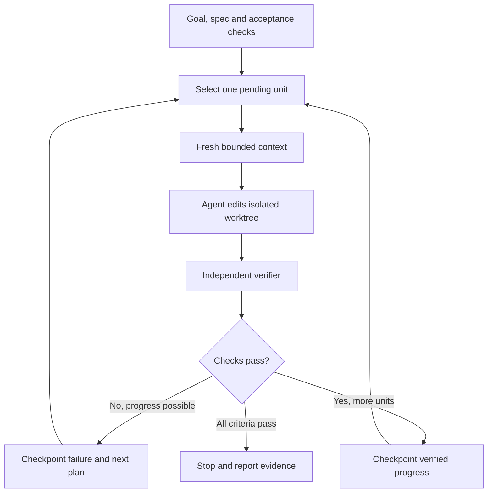

# ForgeWeave: Python CLI Agent Harness — End-to-End System Design

**Status:** implementation blueprint, updated 4 October 2026. **Scope:** local Python CLI, optional remote model APIs, Git worktrees, web search/source fetch, Playwright browser with optional browser-use adapter, MCP, skills, custom agents, bounded fan-out/fan-in, workflows, observability and supervised Ralph mode. Laya is deferred by ADR-001. Editor, web application and hosted control plane are future work. **Normative companion:** [AGENTS.md](./AGENTS.md). [Coverage matrix](docs/feature-coverage.md) and [source review](docs/research/harness-source-review-2026-10-04.md) distinguish requirements from implementation.

## 1. Problem, principles and boundaries

The [SoL-Pi review](docs/research/sol-pi-review-2026-10-04.md) and [ADR-003](docs/architecture/adr-003-evidence-preserving-harness-optimization.md) inform the optional optimization and shipping contracts in section 15. These extend existing native guarantees; measured release evidence must justify enabling optimizations.

Section 14 and ADR-002 supplement sections 5, 9 and 10 with explicit harness/loop engineering, delegation, joins, research tools and diagnostic contracts. Existing security, durability and ownership contracts in section 13 remain required.

ForgeWeave takes a development request to an inspected, verified patch while making each consequential action explainable. The harness owns the task lifecycle, model interaction, context construction, tool policy, workspace, memory, verification and audit trail. The language model proposes actions; the harness validates and executes them. This is consistent with the public Codex agent-loop explanation, and avoids confusing a model's answer with an executed action. See [Codex agent loop](https://openai.com/index/unrolling-the-codex-agent-loop/) and [harness engineering](https://openai.com/index/harness-engineering/).

The first product is local-first and Python-native, including Windows 11 without Docker, WSL or Redis. It must start with SQLite, a filesystem artifact store and a native process runner. Hosted scale, enterprise multi-tenancy, browser sign-in automation and editor completion are not release dependencies. Security claims are limited to actual OS controls: a worktree isolates source changes, but is not a process sandbox. Every effect is mediated by an explicit capability and policy decision.

The system must remain usable when Laya, embeddings, the browser, a provider or MCP is unavailable. Its stable spine is a versioned event log and deterministic policies; model-dependent components are optional adapters. “Memory” means retrieved context with provenance and lifecycle, never a policy source. Completion means verified acceptance criteria, not a model saying “done.”

## 2. Reference patterns and what to adopt

OpenAI's published harness study recommends a short repository knowledge map linked to deeper documents rather than placing an entire design in AGENTS.md. Claude Code distinguishes human-maintained project instructions from agent-written auto memory, and states that both are context rather than enforced configuration. Ralph's original formulation loops over a stable goal and externalized plan, typically one item per iteration; Anthropic's plugin repeats the same prompt with a stop hook and persisted file/Git changes. ForgeWeave adopts externalized specifications and iteration, with deterministic completion checks, permission boundaries and hard stop conditions. Sources: [OpenAI harness engineering](https://openai.com/index/harness-engineering/), [Claude Code memory](https://code.claude.com/docs/en/memory), [Geoffrey Huntley's Ralph explanation](https://ghuntley.com/ralph/), [Anthropic Ralph plugin](https://github.com/anthropics/claude-code/blob/main/plugins/ralph-wiggum/README.md).

Source-available Pi, OpenCode, Kimi Code, DeepSeek Harness and Codex provide examples of a small agent loop, persistent sessions, adapters and extension points. Their design details may change; pin commits for implementation studies. Laya supplies fast typed decisions, not coding-model tool execution. Playwright supplies isolated browser contexts and traces; MCP supplies tools, resources and prompts with transport and authorization concerns. Use [Pi](https://github.com/badlogic/pi-mono), [OpenCode](https://github.com/anomalyco/opencode), [Kimi Code](https://github.com/MoonshotAI/kimi-code), [DeepSeek Harness](https://github.com/deepseek-ai/deepseek-harness), [Laya](https://github.com/Idk507/laya), [Playwright Python](https://playwright.dev/python/docs/intro), and [MCP specification](https://modelcontextprotocol.io/specification) as source references. Preserve evidence level in research notes: source-verified, vendor-documented or inferred.

## 3. System topology

A user command creates a Task with immutable initial request, base commit, authorized scopes, chosen agent, budget and acceptance criteria. The Task Controller allocates a worktree, creates a session and persists the first event. The deterministic eligibility policy filters agents/models/tools. The Context Builder assembles a bounded prompt. The System 2 model either produces a response or structured tool requests. The gateway validates name, schema, arguments, capability and effect before executing. Results and verification become events. A normal task ends when the agent provides a final answer and required checks pass; a Ralph task invokes another bounded iteration if objective criteria remain unmet.

The canonical package map is plan.md section 5: `contracts`, `events`, `task`, `core`, `sessions`, `routing`, `models`, `context`, `memory`, `tools`, `policy`, `workspace`, `browser`, `mcp`, `skills`, `agents`, `automation`, `ralph`, `verify`, `engines`, `plugins`, `hooks`, `integrations/github`, `telemetry`, `cli`, and `sdk`. Contracts are dependency-light. Adapters depend inward on contracts; core never imports concrete provider/browser/MCP implementations. Use an application composition root to wire them, and enforce package boundaries with import tests. `verify` is canonical; do not create a duplicate `verification` package.

## 4. State ownership and persistence

SQLite in WAL mode owns Task, Session, Turn, Event, Approval, Worktree, ArtifactIndex, MemoryEntry, Automation, Iteration and Lease tables through their owning repositories. Large outputs, screenshots and traces live in a task-scoped artifact directory addressed by content hash; SQLite stores paths, hashes, mime type, redaction status and retention. Every event has a monotonic per-task sequence, event ID, task/attempt/parent IDs, actor, UTC timestamp, schema version and payload reference. Append `ToolCallRequested` and `PolicyDecision` before execution, then `ToolResult` or `ToolFailure`. Maintain write-ahead events and idempotency tokens; recovery reconciles ambiguous side effects before retry. A Git commit or patch hash is the canonical source-change checkpoint. Database migrations are explicit and reversible where feasible; backup and restore tests cover SQLite plus artifacts together.

Session state is a projection of events, not an independent mutable truth. A session branch references a parent event sequence and diverges from there; it may attach to a separate Git worktree. A resume checks repository base/head, worktree ownership, active subprocesses, model/provider availability and approval status before constructing new context. Replaying old model outputs or tool calls for audit never executes them. Re-execution requires a new attempt and policy check.

## 5. Agent loop and task state machines

Task states are CREATED, PREPARING, RUNNING, WAITING_APPROVAL, WAITING_EXTERNAL, VERIFYING, COMPLETED, FAILED and CANCELLED. Iteration states for Ralph are QUEUED, SETTING_UP, EXECUTING, CHECKING, CONTINUING, BLOCKED and STOPPED. Transitions are atomic with event persistence. The loop receives `ContextPacket`, `ToolCatalog`, `Budget` and `CancellationToken`; validates model output; resolves zero or multiple tool requests; dispatches independent read-only calls concurrently where safe; serializes edits to a worktree; appends observations; and evaluates stop conditions. A tool result is data, never a new instruction. Retries must be classified as safe/idempotent, conditionally reconcilable or non-retryable.

Laya is a deferred, optional future integration under ADR-001 and has no current implementation milestone. Native development uses deterministic eligibility and user-selected model routing. If reconsidered after the M1 native gate, Laya may classify domain, difficulty, intent, need for tools/browser/write, risk indicator, agent profile and tool families; it must never override a pinned user model, grant permission, or construct tool arguments. Hard filters must remove unavailable or forbidden choices before it runs, and active use requires a ForgeWeave coding-task dataset with calibration evidence.

## 6. Context management: the central design

The model's context window is a working set, not a database. The Context Builder selects the minimum material required for the current objective, preserving exact references to omitted evidence. Let W be the provider context limit, O the reserved output, T the maximum tool-result allowance and S a safety margin. The input budget is B = W − O − T − S. Allocate B dynamically across instructions, current goal/plan, recent turns, retrieved code, durable memory and relevant tool evidence. Tokenize with a provider-compatible estimator when possible; fall back to conservative byte-based estimates and respond to provider length errors by dropping lowest-value material, never silently truncating the user's latest request or policy.

Build the prompt in this order: trusted platform and task policy; concise repo instruction map with path-scoped rules; explicit current user objective and acceptance criteria; current worktree/branch/test state; recent conversational turns; relevant code snippets with path and line or symbol provenance; short verified memory records; selected tool schemas; and bounded recent tool results. Tool outputs have a hard byte/token cap, with full outputs in artifacts and a searchable pointer. Prioritize an error's cause and relevant stack frames over its full log. Prefer exact/lexical `rg`, Git diff/history, tree-sitter or LSP symbols, imports and diagnostics before embeddings. An optional semantic index is scoped to allowed repo content, content hashes and commits, with lexical fallback and evaluation. Keep a retrieval ledger: query, tool, candidate IDs, chosen spans, source hash and use in final answer.

Use four context operations. **Trim** removes irrelevant earlier turns and duplicated tool output. **Summarize** produces a compact task-progress record containing decisions, changed files, test outcomes, unresolved questions and event citations; verify factual claims against events before using it. **Rehydrate** retrieves a source artifact, file or event when details are needed again. **Reset** starts a fresh inference context for a new Ralph iteration while retaining authoritative external state. Summaries never overwrite transcripts. Trigger compaction at a configurable fraction of B, before a large retrieval, and after meaningful checkpoints; never wait for a context overflow. Measure answer accuracy after compaction and detect “lost constraint” failures. OpenAI's [session memory example](https://developers.openai.com/cookbook/examples/agents_sdk/session_memory) describes trimming and compression as useful patterns.

Context invalidation is mandatory. A file snippet is stale when its content hash changes; symbol maps and embeddings invalidate on commit or file hash; a test failure ceases to describe current code after the failing files change until rerun. Keep context provenance and TTL. A subagent receives selected goal, constraints, relevant references and parent checkpoint, not a transcript dump. A browser snapshot expires when page navigation or DOM-changing action occurs. MCP resources are cached only according to server-advertised semantics and local sensitivity rules.

## 7. Memory model and write policy

**Working memory** is ephemeral per model turn: selected code spans, latest observations, current plan and unresolved questions. It is reconstructed by the Context Builder. **Short-term session memory** is the event-backed record of a task's turns, changes and approvals, plus verified checkpoints and summaries. **Episodic memory** records a completed task's problem, solution, outcome, relevant commits and verified lessons. **Long-term project memory** contains stable build commands, architecture conventions, ownership, repeated pitfalls and source references shared across sessions/worktrees. **User memory** contains explicit preferences and repeated corrections with user-visible edit/delete controls. **Procedural memory** is a versioned skill, runbook or AGENTS.md instruction authored or accepted by a human. These types must be stored and retrieved separately so an agent-written observation cannot become an instruction.

Represent durable entries with `id, scope, type, text, source_event_ids, source_paths_and_hashes, confidence, verification_status, created_at, last_verified_at, expires_at, sensitivity, owner, revision`. Scope can be user, repository, branch, task or agent. The default promotion path is candidate → source-verified → accepted; one-off unverified model claims stay in session events. Promote only facts with evidence or an explicit user correction. Detect duplicates and contradictions; newer evidence does not silently overwrite a user preference or an earlier fact. Mark superseded entries and retain lineage. Attach expiry to transient API behavior or repository topology; reverify build commands after changes to configuration files. Support `fw memory list|show|search|add|approve|edit|forget|export`; log edits. Repository memory respects privacy settings and does not cross repo boundaries automatically.

Retrieval starts with scope filtering and exact keyword match, then optional local embedding search and reranking; include only a few high-value entries, each with source and verification date. Do not auto-inject the entire memory store. A stored instruction from a repo, website, issue or MCP response cannot change policy authority. Never store secrets, credentials or sensitive source content by default; redact before persistence, encrypt sensitive opted-in records and set retention. Evaluation includes correct recall, stale-memory injection, contradiction handling, cross-repo leakage, forget semantics and usefulness over a no-memory baseline. See [Claude Code memory](https://code.claude.com/docs/en/memory) and [Codex memories](https://developers.openai.com/codex/memories).

## 8. Ralph mode: supervised long-horizon iteration

Ralph mode is an **optional outer loop**, separate from the inner tool-calling agent loop. Its input is an immutable goal, versioned acceptance specification, optional plan file, max iterations, wall-time/cost budgets, permitted tools, approval rules and worktree branch. Each iteration chooses exactly one highest-priority unfinished unit, builds a fresh context from spec + current plan + Git diff + last verification + relevant memory, performs a bounded agent run, verifies outcomes, checkpoints progress and updates the plan. This reflects Ralph's stable-goal/externalized-state pattern without using a completion phrase as proof. The default is a finite iteration limit and explicit budget.

The controller owns `ralph/goal.md`, `ralph/spec/*.md`, `ralph/plan.json` and `ralph/progress.jsonl` in a task artifact directory. Plan entries include ID, dependency, description, objective validator, status, attempt count and evidence references. The controller, not freeform model text, transitions status. In a repository where such files are meant to be checked in, require an explicit option; otherwise keep them out of the source tree. The agent may propose a plan update, but the controller validates schema and guards against deleting required acceptance criteria. A progress summary is a pointer to verified artifacts rather than the sole record. Checkpoint a commit only when it meets configured tests, or store a labeled unverified patch so recovery can distinguish it.

Stopping conditions are: all acceptance validators pass and no open required unit; explicit user cancellation; budget/iteration limit; repeated identical failure with no changed hypothesis; no progress in N iterations; policy denial requiring a user; provider/tool outage; or an unsafe workspace state. Stop when the validator says done, even if a model asks for another iteration. A completion phrase may be logged for compatibility but never serves as the sole stop signal. A stalled loop should present the failing check and best next action, not spin. A user can inspect, pause, resume, revise goals through a new spec version, or stop with `fw ralph start|status|pause|resume|stop|explain`. On resume, reconcile the worktree and event log before iteration. Ralph does not automatically approve tool calls or permit unrestricted shell/browser/network access.

Adversarial tests include the model falsely claiming success, repeatedly changing the same lines, oscillating between two implementations, a flaky verifier, changing acceptance criteria, context summary losing a requirement, process crash between patch and event append, and a subagent conflict. Evaluate completion rate, regression rate, iterations per accepted change, cost, stall detection, and human intervention. The default workflow is single agent and one plan item per iteration; independent subagents are an explicit opt-in with separate worktrees.

## 9. Tool, workspace, browser, skill and workflow integration

All tools implement `describe() -> ToolSpec`, `validate(args) -> ParsedArgs`, `effects(args) -> EffectSet`, and asynchronous `execute(args, context) -> ToolResult`. EffectSet includes read/write paths, network destinations, browser state mutation, external API operation and secret usage. The policy gateway intersects user/task/agent/skill/MCP permissions, then returns allow, deny or ask; the model is never the authority. Shell processes have cwd, timeout, output cap, cancellation and environment allowlist. Patch edits include expected hash. Git worktrees are owned per mutating task/subagent; cleanup only after checking uncommitted changes. The original checkout remains untouched until an explicit apply/merge. See [Git worktree](https://git-scm.com/docs/git-worktree).

Playwright async Python uses one isolated nonpersistent BrowserContext per task, named pages, bounded locator waits, accessibility/DOM snapshots, screenshots, downloads and redacted traces. Revalidate URLs and redirects, block unauthorized loopback/private targets, expire snapshot element references on DOM mutation and distinguish navigation from submission. MCP uses namespaced tools, resources and prompts with schema validation, timeout, auth and catalog cache rules; MCP content is untrusted. Skills are lazily discovered by metadata and loaded only when relevant; scripts remain governed by shell policy. Custom agents specify model/tool/skill allowlists, budgets and delegation limits; subagents inherit a subset of their parent's authority.

An automation definition maps cron or an event to a versioned workflow DAG and task. The local CLI can run a scheduler process or export to Windows Task Scheduler/cron; headless invocations use JSON output. SQLite stores idempotency keys, lease, run history and task link. Approval can pause and resume a step. A crash must not reissue an external side effect without reconciliation. Ralph mode can be one workflow step or own the overall development goal, but cannot recursively launch another Ralph controller.

### Optional delegated engines and reused design patterns

The harness stays native. `engines` hosts optional backends (DeepSeek Harness via `deepseek-harness-sdk`, OpenAI Codex via `openai-codex`) that run as one ForgeWeave task in one ForgeWeave worktree; their events are imported as untrusted observations and ForgeWeave's verifier decides completion. Isolation is reported as `mediated` (engine reaches tools only through a ForgeWeave-served MCP endpoint, so each call passes the policy gateway; feasibility to be spiked) or `delegated-unmediated` (explicit opt-in, worktree-only, no external effects). Verification adopts the codex-harness regression policy natively: BEFORE/AFTER findings per file, analyzer, rule and qualified symbol; worsen-only numeric metrics; occurrence counts for diagnostics; fail-closed infrastructure errors that do not consume the repair budget; Git-based snapshots so shell edits are covered. From DeepSeek Harness we adopt: model-visible means logged, scoped plugin registrations that unwind on unload, named interception points around steps and tool execution, capability seams, layered configuration with an effective-config dump, and never-rewritten session log generations with adjacent migrations. See [plan.md](./plan.md) section 4.1 for sources and evidence level.

## 10. Security and operations

The attack surfaces are prompt injection in code/issues/web pages/MCP, untrusted plugins and skills, malicious shell output, browser SSRF, path traversal, credential leakage, concurrent worktree writes, automation replay and memory poisoning. Separate trusted policy from lower-trust content. Use OS keyring for local credentials when available, file permissions for SQLite/artifacts, encrypted opt-in sensitive records, scoped tokens and redaction. Threat-model the native executor honestly: without OS sandbox support, prompt approval is a control, not containment. Audit all approvals and effects. The agent should not autonomously run downloaded scripts, publish code, submit web forms or push branches without task authorization.

Structured spans include task, iteration, context build, retrieval, Laya, model, policy, tool, verification and memory retrieval/promotion. Record tokens estimated and billed, latency p50/p95, tool errors, approvals, context utilization, stale-retrieval hits, compaction failures, memory usefulness, Ralph stall rate and cost per accepted patch. Default local telemetry is JSON; avoid storing raw secrets or full prompts. Offer a trace export that reproduces the decision sequence with redacted artifacts.

## 11. Implementation sequence and concrete gates

**Stage 0 — Contracts and fixtures.** Define Pydantic schemas, event versioning, migrations, effect taxonomy, prompt authority, model/provider contract and task fixture repository. Write architecture decision records and threat model. Gate: schema round trips and an event log can be rebuilt into identical task state.

**Stage 1 — Deterministic local harness.** Implement CLI, SQLite events, worktree lifecycle, read/search/patch/shell, provider adapter, policy gateway, cancellation and verification. Gate: fix a seeded bug on a branch; crash and resume without duplicating a side effect; original checkout unchanged; Windows native run succeeds.

**Stage 2 — Context and session memory.** Add instruction resolution, token budgeting, retrieval ledger, incremental context builder, trim/summarize/rehydrate, session snapshots and branch sessions. Gate: long-session benchmark retains acceptance criteria and correct file provenance after several compactions; replay never executes tools.

**Stage 3 — Tools and extension seams.** Add skills, MCP stdio, Playwright browser, hooks, custom agents and isolated subagents. Gate: injected prompt cannot grant an action; browser and MCP effects are audited; conflicting writers never share a checkout.

**Stage 4 — Long-term memory.** Add candidate memory promotion/review, scoped retrieval and forget/export. Laya routing is deferred outside the active delivery sequence by ADR-001. Gate: deleted memory is absent from later prompts and search.

**Stage 5 — Ralph controller and automation.** Add versioned specs, one-unit iterations, independent verifier, stagnation detector, checkpointing, cron/event workflows, idempotent leases and headless JSON mode. Gate: false completion is rejected; repeated failure stops; crash mid-iteration recovers; duplicate event yields one task.

**Stage 6 — Hardening and release.** Evaluate memory against no-memory runs and Ralph against a single long run. Add security/fault tests, packaging, migration/backup/restore, docs and examples. Laya routing remains outside the release scope unless a later ADR reintroduces it with held-out metrics and safety thresholds.

The final end-to-end acceptance scenario: a scheduled GitHub issue starts a task; an isolated branch/worktree is created; deterministic policy selects permitted capabilities; a custom agent loads a skill and consults scoped project memory; a read-only subagent investigates; the main agent edits and uses Playwright to check a local UI; an MCP tool supplies permitted external context; a failing test triggers a bounded Ralph iteration with fresh context; the verifier passes; a reviewer sees diff, evidence and trace; an authorized CLI command creates a draft PR. Test the same flow after interrupting and resuming at three distinct boundaries.

## 12. Known design risks and explicit decisions

Large automatic memory stores can contaminate prompts; durable memory therefore needs scoped retrieval, citations, expiry and review. A long AGENTS.md can crowd out code context; keep it as a concise index once this system design becomes the source of truth. Laya's shipped confidence may be miscalibrated for coding tasks; its implementation is deferred until native reliability evidence justifies evaluating it. Ralph can amplify errors and cost; finite budgets, one item per iteration, independent checks and stall detection are mandatory. Native worktrees protect repository state but do not contain hostile processes; policies and user-visible approvals remain necessary. Browser snapshots and MCP catalogs can become stale; every execution revalidates current state. The first release prioritizes correctness, auditability and recovery over maximal autonomy.

## 13. Pre-development operational contracts (2026-10-02)

This section is normative together with [ADR-000](docs/architecture/adr-000.md). [Research and gap assessment](docs/research/architecture-review-2026-10-02.md) distinguishes evidence from proposals. Delivery follows M0–M6 in plan.md; section 11 stages are conceptual groupings. These are requirements to implement, not claims of working functionality.

### 13.1 Context packet, protected constraints and compaction

`ConstraintLedger` stores stable requirement IDs, origin/authority, exact text or authorized reference, acceptance validator, spec version and supersession. Only authorized user/spec changes supersede required criteria. Model summaries cannot edit it. `ContextManifest` records request ID, task/attempt, provider/model and adapter version, effective policy/config hashes, workspace revision, catalog version, ordered span IDs/hashes, authority/sensitivity, token estimates, omitted spans/reasons, and summary lineage. `ContextPacket` is assembled from this manifest; role boundaries survive provider serialization. Every selected item is current and permitted for the destination provider. Quoting an injection never promotes its authority.

Initial tunable defaults: output reserve from provider/model configuration; tool allowance 10% of W, safety margin 5% of W, input B as section 6. Trigger compaction at 75% of B or before predicted incoming content exceeds B. These are benchmark hypotheses. Protected policy, active requirement ledger, latest user request and required schemas must fit first. If they alone exceed B, return CONTEXT_UNSATISFIABLE with a visible explanation; never truncate protected content or silently change models. Allocate the remainder by relevance and freshness, with memory initially capped at 5% of B. Use provider token counting when supported; record conservative estimates and actual usage separately.

`SummaryRecord` contains source event range, cited decisions, unresolved work, changed-file hashes, verification fingerprint, schema version and constraint-ledger hash. Build it as a disposable candidate; validate citations, protected requirement coverage and trust labels before adoption. If validation fails, use deterministic extracts and references. Missing facts remain unknown. Keep tool-call/result pairs valid under each provider's protocol. After an edit, refresh affected spans and invalidate verification for the changed workspace; do not repeatedly inject obsolete diagnostics as current evidence.

Prompt overflow permits one bounded rebuild dropping optional material and rechecking provider rules, then stops clearly. Summarization/retrieval uses the same cost and latency budgets as other model/tool calls. Cancellation during compaction preserves the last valid manifest. Rehydrate only retained, permitted evidence; an expired artifact is reported unavailable. Cache entries are keyed by scope, content/policy/provider/catalog revision; do not reuse private spans across repositories or providers.

Expose `fw context inspect --task ID`, `fw context explain --request ID`, and a redacted export showing allocations, provenance, omissions and summary lineage. M1 fixtures cover small windows, oversized requirements, multi-tool protocol pairs, repeated compaction, provider switch, changed code, secret exclusion and summary injection. Proposed gate: zero lost protected requirements across ten compactions in deterministic fixtures; sampled summaries have no unsupported claims; overflow terminates within the configured rebuild limit. Evaluate task quality against uncompacted same-model baselines separately.

### 13.2 Replay fidelity and data lifecycle

Resolve the tension between exact reconstruction and not persisting sensitive prompts: default audit records retain redacted selected context and ordered manifests, never secrets or full sensitive source. Label each request `exact-retained`, `redacted`, or `reference-only`; hashes cannot reconstruct missing text. Exact retained payloads require explicit sensitive-content retention consent and encryption where applicable. A replay reports fidelity and missing artifacts rather than pretending redaction is lossless. The lossless event-order guarantee applies to retained events, not indefinitely retained raw content or provider hidden reasoning.

Retention settings cover prompts, artifacts, browser traces, memory, caches, exports and backups. `forget` removes retrieval eligibility immediately and performs scoped content deletion with an audit tombstone; it cannot promise erasure from already exported backups or remote providers. Keep append-only audit metadata free of raw secrets. Artifact access is task/repository-scoped even when hashes match. Downloads and traces are untrusted; exports redact by default.

### 13.3 Authorization and actual isolation

`ApprovalGrant` binds task/attempt, tool/schema/catalog version, canonical argument/effect hash, workspace preconditions, policy revision, human actor, allowed scope, expiry and consumption state. Default is one action. An explicitly granted bounded session scope can cover matching actions; changed effects/preconditions require reauthorization. Noninteractive runs fail with a structured approval-needed result instead of hanging. Grant verification and consumption are atomic before dispatch. Revocation or policy tightening invalidates pending grants. Model/tool/engine text never counts as human consent.

`ExecutionProfile` reports filesystem, network, credential, process-tree and resource containment independently, with backend and measured evidence. A cwd or worktree is not a sandbox; Job Objects do not alone establish filesystem/network controls. Arbitrary shell commands, test suites, Git hooks and dependency scripts can spawn tools and access unrelated data. Argument checks cannot prove their effects. Require a tested confinement backend for restricted execution; if unavailable, fail closed or obtain explicit task authorization for visibly unconfined execution. Do not silently downgrade. Distinguish provider API egress from shell/browser/MCP egress so a model connection does not imply general network access.

Validate Windows case folding, junction/reparse points, UNC/device paths, alternate data streams, drive-relative paths and path replacement races. Isolate HOME/temp and credential environment; retain only required variables. Git hooks/config and repository test commands are executable input, subject to policy. Render tool output as escaped text, filter terminal control sequences, and separate human-facing stderr/progress from machine JSON on stdout. Browser redirects/subresources and MCP auth discovery use the shared egress rules; DNS prechecks alone do not establish containment.

### 13.4 Durable execution and uncertain outcomes

`ToolExecution` has REQUESTED, AUTHORIZED, DISPATCHING, SUCCEEDED, FAILED, CANCELLED or OUTCOME_UNKNOWN, effect fingerprint, idempotency key and reconciliation evidence. These execution states do not add task lifecycle states. Cancellation after an effect may leave OUTCOME_UNKNOWN. Persist dispatch intent before invocation; after restart reconcile actual files/processes/remote operation IDs. Pure reads may retry; hash-conditional writes reconcile first; external/non-idempotent effects never blindly retry. When remote idempotency or outcome lookup is absent, park the task in WAITING_EXTERNAL for explicit resolution. Exactly-once external execution is not promised.

Use SQLite WAL on local storage, bounded busy timeout and short transactions; default `synchronous=FULL` for authoritative action events. Check supported SQLite runtime/version at startup. Owner repositories use a shared unit of work so lifecycle updates and their events commit atomically. Artifact publication writes a temporary file, flushes, validates hash and atomically renames before indexing; recovery handles orphan artifacts and missing/corrupt references. State storage has quota checks; failure to persist authorization prevents dispatch. Backup uses SQLite's supported backup mechanism plus a consistent artifact manifest; never copy the live database alone.

Leases carry owner, expiry and monotonically increasing fencing token. Every owner mutation verifies the current token; a stale process cannot commit after takeover. Reconcile already-started processes before acquiring a conflicting writer lease. Use monotonic time for active deadlines and UTC for persisted timestamps. Child/process shutdown has a bounded grace period followed by escalation with outcome recorded. Test kill-before/after every dispatch/persistence boundary, busy/disk-full conditions, missing artifacts and competing resumptions.

### 13.5 Provider streams and budget accounting

`ModelTurn` assembles streamed text and tool arguments with bounded bytes/count/depth and unique call IDs. Never dispatch partial JSON or calls from an incomplete/interrupted turn. Preserve documented provider continuation/reasoning blocks without treating them as instructions or requiring disclosure of hidden chain of thought. Validate missing usage, malformed chunks, disconnect after partial content, finish reasons and multiple-call ordering with fake streams and authorized live smoke tests. Retry policy accounts for possible double billing; no retry implies repeating a previously dispatched tool.

`BudgetLedger` reserves estimated cost/tokens before model, compaction and delegated calls; reconciles actual reported usage and aggregates retries/children. Missing usage retains a conservative reservation; unknown prices cannot silently disable a configured monetary ceiling. Track currency, price-source version, cached tokens and estimates separately. Time, turns, tool count, cost and token ceilings all apply in M1. M5 refines estimates and optimization rather than introducing basic safety limits.

### 13.6 Acceptance, diagnostics and scope gates

`AcceptanceSpec` is versioned and human-visible. `VerificationRun` records criterion IDs, command argv, cwd, environment profile, timeout, exit code, bounded output artifact, verifier/config version and workspace fingerprint including untracked inputs. Changed tests/validators are reviewable; deleting or weakening them cannot establish completion. Baseline debt comparison supplements required correctness/security checks and cannot excuse new behavior failures. Independent verification means a separately enforced harness check, not necessarily another LLM. Flaky/infrastructure outcomes remain inconclusive; bounded retries do not manufacture a pass. A harness-wide repair limit and repeated-failure fingerprint prevent RetryBudget resets from creating endless loops.

`fw doctor --json` performs read-only local checks for storage, Git ownership, runtime, credentials presence (never values), optional capabilities and isolation evidence. Network health checks are explicit. Before creating a worktree, resolve the intended Git root and reject ambiguous ancestor repositories pending user selection. Publish a Windows/Python support matrix and cold-start/cancellation/resume measurements. M1 acceptance is the native single-agent vertical slice; it is not completion of the full CLI feature inventory. The first full CLI release follows the acceptance scenarios in AGENTS.md, including gated browser, MCP, custom agents, delegation, workflows, memory and Ralph capabilities. External engines remain optional. Laya is deferred outside the active release plan by ADR-001.

## 14. Harness, loop, orchestration and research contracts (2026-10-04)

Normative amendment under [ADR-002](docs/architecture/adr-002-harness-coverage-and-research-tools.md). Evidence and limits are in the [source review](docs/research/harness-source-review-2026-10-04.md). This section defines ForgeWeave behavior, not vendor implementation claims. Existing canonical event names and section 13 guarantees remain unchanged. The [coverage matrix](docs/feature-coverage.md) is a requirement index, not a second state store.

### 14.1 Harness engineering and loop engineering

Harness engineering covers the environment and control system around inference: reproducible workspace/configuration, inspectable instruction and context packets, schema-valid tools, authoritative effects/policy, cancellation, budgets, persistence, verification, diagnosis and measured improvement. A prompt alone cannot enforce those guarantees. Keep repository architecture legible through a concise instruction map, owner boundaries, executable checks and versioned acceptance fixtures. Evaluate harness changes against pinned task inputs and baseline outcomes; record improvements and regressions rather than asserting feature parity.

Four distinct loops have separate owners and stop conditions:

| Loop | Owner | Unit | Stop/recovery |
|---|---|---|---|
| Inference/tool loop | `core` | One step: assemble -> infer -> parse -> validate -> authorize -> dispatch -> observe | Final candidate, cancellation, approval, failure or budget; partial stream is not dispatchable |
| Verification/repair loop | `core` coordinating `verify` | Verify workspace fingerprint; repair one reported failure | Acceptance passes, global repair cap, repeated identical failure or inconclusive infrastructure outcome |
| Orchestration/workflow loop | `agents` / `automation` | Admit eligible children/steps, await results, join and integrate | Explicit join/failure policy, bounded drain, approval or run budget; persist admissions before starting |
| Long-horizon loop | `ralph` | One prioritized unit with fresh context and independent check | Verified goal, limits, cancellation, stall or policy block; cannot recursively start itself |

Each step records context-manifest hash, catalog revision, provider/options, usage reservation, stream finish reason, requested calls and stop reason. Assemble tool-call fragments by call ID/index and validate only after a complete accepted stream. Reuse section 13.5 stream and usage contracts. Invalid calls produce structured observations and bounded correction, never guessed arguments. User steering enters through validated admission at a step boundary; it cannot mutate committed context retrospectively.

Tool concurrency requires independent effects, bounded worker capacity and policy revalidation just before execution. Prepare requests in model order; serialize workspace writes and overlapping effects. Record actual execution/result timing in events; build model-visible observations in stable request order. Cancellation stops new dispatch, signals active processes and streams, and waits only for bounded cleanup. Uncertain side effects enter reconciliation. Hooks have deterministic ordering, explicit failure behavior and recursion limits; observational callbacks cannot suppress authoritative outcomes. A required policy/check hook failure blocks execution, while an optional diagnostic observer failure is recorded without fabricating success.

Acceptance: fake streams with interleaved/truncated calls never execute incomplete requests; concurrent reads complete out of order without corrupting context order; conflicting writes serialize; cancel during preparation/dispatch/repair leaves coherent records; global budgets cannot reset through retries or descendants; replay reproduces packets without effects.

### 14.2 Custom agents and task delegation

An `AgentDefinition` is a reusable role; a `DelegationRequest` creates work; a `ChildRun` is a runtime instance. A workflow composes runs; it is not a role definition. Built-ins stay explore, plan, implement, review, test and browser. Definition fields include version/hash, purpose, instructions, model eligibility, tool/skill/MCP allowlists, read/write/network/browser scopes, budget limits, delegation rights, verification and output schema. User-pinned model choices remain explicit. Definition permissions intersect with parent/task policy; no profile can expand authority.

`DelegationRequest` contains request/idempotency ID, parent task/attempt/agent, role-definition hash, objective, criterion IDs, allowed scope/effects, base commit/workspace fingerprint, context-manifest reference, budget reservation, deadline, context mode, join membership and output schema. Default context is a selected packet: exact objective, protected constraints, relevant instructions, code/evidence references and expected output. Explicit conversation fork records its source sequence and still filters disallowed or unrelated data. Child histories remain separately inspectable; only bounded summaries and evidence references return to the parent working context.

Child lifecycle: QUEUED -> STARTING -> RUNNING -> WAITING_APPROVAL / WAITING_EXTERNAL -> VERIFYING -> SUCCEEDED / FAILED / CANCELLED; startup rejection is a recorded terminal outcome. Idle is an activation state, not successful completion. Reserve child identity, aggregate budget and writer workspace ownership before launch. A one-shot run is the first implementation; continuable children later retain the child identity and create new attempts. Restore durable children after restart and reconcile outstanding calls before waking them.

Proposed policy-controlled tools are `agent_spawn`, `agent_send_message`, `agent_wait`, `agent_list`, `agent_interrupt` and `agent_continue`. Child messages carry message ID, sender, recipient, correlation, causal event, content reference and receipt state. Receiving a message cannot grant permissions. Persist receipt before reporting delivery; deduplicate retries and record consumed sequence/cursor. Wait subscribes to activity/completion with a bounded timeout; no busy model polling. Default messaging follows parent-child lineage; peer messaging requires an enabled group policy. External email/Slack/publication remains separate explicitly authorized tooling.

Children share root caps for total descendants, depth, concurrency, time, tokens and cost, with per-child reservations. Returning a reservation reconciles actual spend, not a reset. Read-only workers operate on a pinned snapshot; every writer owns a distinct linked worktree. The integrator owns its own workspace. Failure of one worker follows group policy and does not silently cancel independent siblings. Parent cancellation drains its children with a bound and records any unresolved activity. Approval waits retain scope; resumed calls revalidate action, workspace and policy hashes.

Acceptance: duplicate spawn produces one child; concurrent admission cannot exceed a root cap; child role cannot widen write/network permissions; stale context/base fails before integration; messages survive restart without duplicate consumption; continuation preserves lineage and aggregate spend; cancellation and startup failure release ownership safely.

### 14.3 Fan-out, fan-in and integration

Fan-out creates a versioned `JoinGroup` from an explicit bounded member set or bounded map over a captured input artifact. Store member IDs/order, definition/input hash, base revision, root reservation, deadline and join/failure policy before launching children. Never let a model create an unlimited worker tree. Proposed join modes are `all_success`, `all_settled`, `quorum(k)` and `first_verified`; quorum counts validated results, not completion messages. Reject invalid k, duplicate members and unknown members. Dynamic membership changes require a new group revision, never mutate an in-progress barrier silently.

Fan-in validates a `ChildResult`: member and attempt IDs, outcome, structured summary, criterion evidence, patch artifact/base hash, changed paths, verification fingerprint, usage and open risks. Results are deduplicated by member/attempt, validated and ordered by captured membership rather than timing. Required members cannot disappear from a successful group. Partial results retain failure information. Fail-fast stops admission and cancels active siblings with bounded cleanup; collect-errors preserves independent work. Quorum/first-verified groups specify whether remaining children are cancelled or drained; retain their audit and spend either way.

An analysis join reduces cited findings; a coding join requires integration. Review each patch against assigned scope/base and protected inputs; detect overlapping writes and ancestry conflicts. Apply reviewed patches through a visible three-way merge into the integrator workspace, then run verification on the combined fingerprint. Individual green worker checks do not establish merged correctness. Preserve rejected/conflicting patch artifacts and original worker worktrees for inspection. Parent receives provenance linking every accepted change to its worker, source context and verification.

Acceptance: reverse completion order gives the same aggregate order; duplicate/late/stale results cannot satisfy a join twice; worker crash/timeout produces a terminal member result; quorum cannot count malformed evidence; cancellation does not leak workers; individually passing conflicting patches require merge resolution and combined checks.

### 14.4 Programmable workflows and automation

`automation` owns workflow definitions/runs; `agents` owns worker scheduling; `core` owns individual loops. Workflow execution can be manual without a schedule. Define versioned `WorkflowDefinition`, `WorkflowRun`, `WorkflowStep`, `StepAttempt`, `JoinGroup` reference and artifact bindings. Definitions include typed inputs/outputs, node IDs, dependencies, agent/tool/verification/approval/condition/map/join steps, bounded retries/deadlines and failure policy. Store immutable definition/input hashes at run admission. Validate cycles, missing dependencies, type mismatches, unauthorized capabilities and resource caps before effects. Conditions use a constrained expression language; initial release never evaluates model-provided Python/JavaScript.

Step lifecycle: PENDING -> READY -> RUNNING -> WAITING_APPROVAL / WAITING_EXTERNAL -> SUCCEEDED / FAILED / CANCELLED / SKIPPED. Persist attempt, lease/fencing token and idempotency key before dispatch. Bind dependent inputs to artifacts only after predecessor outputs pass schema and verification. Resume reuses committed successful steps only when definition, inputs and workspace preconditions match; changed inputs create a new attempt or run. Expired lease holders cannot commit. Unknown external outcomes pause for reconciliation. Retry only classified safe/idempotent steps; a workflow retry cannot replenish global budgets. Compensation is an explicit separately authorized step, not a promised universal rollback.

CLI `fw workflow validate|list|run|status|resume` shows dependency tree, active agents, waiting approvals, joins, budgets, artifacts and failed criteria. Templates: research -> plan -> implement -> test -> review; parallel investigation -> cited synthesis; independent patches -> integrate -> combined verification; issue-to-patch; opt-in issue-to-PR; dependency update; UI regression; scheduled triage; docs sync. Schedules/triggers use M4 idempotency and concurrency contracts; successful checks do not imply publication authorization.

Acceptance: malformed DAG fails before a child/tool starts; approval pause survives restart; duplicate triggers admit one run; joins resume from persisted results; crash after external submission does not submit twice; stale lease cannot publish; changed definitions do not silently alter resumed execution.

### 14.5 Web search and implementation research

`tools/web` owns provider adapters and typed tools; `policy` owns query/network authorization; `context` owns selection/citation/invalidation. Do not add a second general tool registry or policy layer. `SearchProvider.search(request, cancellation) -> SearchResponse` supports DDGS first and a user-configured SearXNG endpoint next. The agent receives `web_search(query, domains, recency, max_results, provider)` and `web_fetch(url, max_bytes, format)` through the ordinary catalog/gateway. Search discovers candidates; fetch retrieves evidence. Browser interaction is a separate capability.

Search requests have request ID, sanitized query, explicit backend/provider selection, domain scope, locale/time constraints, result/byte/time cap and authorization reference. Search results contain ID, title, canonical URL, bounded snippet, provider/backend, rank, retrieved timestamp, publication date when known, and artifact hash. Fetch returns requested/final URL, content type, status, fetched time, content hash, bounded excerpt and full retained artifact reference. Unknown publication dates remain unknown; retrieval time is not publication time. Final citations resolve to actual retrieved sources. A search snippet alone cannot support a precise implementation/API claim when source text is available.

DDGS is a synchronous external library: isolate blocking work with enforceable deadline and cleanup. Configure explicit approved backends, reject unknown ones and test that invalid configuration cannot fall back to automatic wider disclosure. Verify dependency network destinations/redirects, not just backend labels. SearXNG uses a configured endpoint with JSON capability check; JSON-disabled, throttled and unavailable responses return structured errors. Fallback is bounded and only to already eligible providers. No automatic public-instance selection, proxy download or local server deployment. Optional provider absence leaves offline repository tools usable.

Queries may reveal private identifiers or error text; check task/repository disclosure policy before sending. Strip secrets and prohibit raw private code in queries without authorized scope. Search is a network effect even if it only retrieves information. Reuse egress controls for DNS/redirects/private addresses and fetch; domain filtering is enforced on result/final URLs. Default TLS verification stays enabled. Cap decompressed response sizes and prevent fetch from executing scripts or downloaded code. Retrieved content remains tainted data and cannot amend instructions or approve actions. Cache keys include provider, query/options and policy scope; retention/TTL and source hashes govern reuse. Redact diagnostic query text; exact context retention follows section 13.

The implementation research flow identifies repository dependency version -> searches official references -> fetches supporting pages -> attaches cited evidence to plan/API decision -> implements -> verifies locally. Record unsuccessful search and contradictions rather than invent evidence. Trigger research for requested browsing, unknown APIs, version-sensitive dependencies or missing external context; use lexical repository retrieval for local facts. Search failure cannot be reported as a successful source check.

Acceptance: fake provider/HTTP fixtures cover normalization, URL deduplication, post-filtering, cancellation, caps, rate limits, malformed results, blocked redirects/private hosts, prompt injection and private-query refusal; optional live checks are explicitly scoped. No actual query goes to a disallowed backend. An end-to-end fake-model task searches, fetches and cites a source through canonical tool events.

### 14.6 Browser-use agentic automation adapter

`browser` retains native Playwright tools. Optional `browser_use` adapter receives a task-scoped browser objective, allowed actions/domains, isolated session, root-budget reservation and cancellation. Its own inference requests must use an accounted model seam; nested calls cannot evade budgets or repository provider policy. Inventory and mediate every default/custom action, including browser navigation, tabs, submission, downloads/uploads, file access, JavaScript, skills and cloud operations. Excluded actions are unavailable, not merely discouraged in a prompt.

M3 spike must prove interception occurs before each effect and that denial prevents the action; a step callback or domain allowlist alone is insufficient. Set `ANONYMIZED_TELEMETRY=false` before import in the adapter subprocess; prevent unintended cloud sync, inherited cookies/credentials and remote browser connections. Verify outbound traffic and redaction on the exact package release. Log individual actions through canonical tool events and link browser state/snapshots/traces. On interruption retain uncertain submission outcomes, close owned contexts and revalidate state on resume. Never replay an old click solely from stored history.

If complete mediation is infeasible, retain an explicit `delegated-unmediated` label and restrict the adapter to approved fixture/read-only experiments until an additional containment/authorization design is accepted. Native browser tools remain available regardless of the optional package. Acceptance covers denied submission/download/file/JS actions, hidden action paths, telemetry-off traffic, max-step/root-budget enforcement, stale state, cancellation and browser cleanup on Windows.

### 14.7 Tracing, observability, logs and evaluation

Section 15 adds candidate freezing, held-out evaluation and full auxiliary-cost accounting to this evaluation contract.

Separate authoritative audit events (`events`) from operational logs/spans/metrics (`telemetry`). M1 adds local JSONL diagnostics when the loop is wired; M2 adds OTel adapters and export. Trace IDs must link task/attempt/turn/step, model request, policy decision, tool execution, workspace fingerprint and verification. Child spans inherit root correlation and retain parent/child links; asynchronous messages/joins use causal links. Every admitted operation receives one terminal diagnostic outcome, including cancellation, startup failure and unknown result, without rewriting audit history.

Log schema: UTC time, severity, component, operation, task/attempt/agent/workflow/step IDs where applicable, trace/span/correlation IDs, event reference, duration, outcome and bounded redacted error. Redact before file/console/export sinks; prompts, source, credentials, query text and form values are omitted by default. Rotate local logs, bound queues/bytes, declare retention and expose dropped-record counts. Optional exporter failure must not lose durable action audit; authoritative storage failure stops new effects. External OTLP/log upload is disabled by default and needs task/repository authorization.

Metrics include model latency/first-token time, token estimate vs billed usage, cost, tool error/timeout/unknown outcome, policy/approval delay, context utilization/compaction/lost constraints, retrieval relevance/staleness, worker queue/active counts, join duration/partial failures, workflow retries, verification/infrastructure failures, and accepted-change/stall rates. Avoid raw filenames/queries as metric labels and uncontrolled high cardinality. Record price/config/version provenance for cost estimates. CLI surfaces: `fw task logs`, `fw trace show|export`, `fw metrics show`, with machine-readable output and links to retained evidence. These are planned interfaces requiring SDK/CLI equivalence tests.

Harness evaluation records task corpus revision, base commit, model/provider/config, tool catalog, constraints, acceptance, budgets, result artifacts and measured usage. Begin deterministic fake-provider fault fixtures in M1; expand to opt-in model trials and representative repository tasks in M2/M6. Compare verified accepted patches, regression, cost, latency, stalls and interventions. Test redaction, causal completeness, exporter failure, disk limits and no-default-network; do not call a feature production-ready solely because a mocked SDK returns success.

## 15. Evidence-preserving optimization and shipping contracts

ForgeWeave requirements under ADR-003; the motivating paper is reviewed separately. These are native design choices, not a copy of published defaults. `context`, `tools`, `agents`, `verify` and `telemetry` retain ownership. Optimizations are individually configurable and off until their acceptance evidence exists.

### 15.1 Observation projections and verified extraction

Define `ObservationProjection` with source event/artifact/hash, scope, original size, excerpt/page references, projection version, disclosure/retention state and explicit omission reason. Model-visible output must remain within the current context budget, even for first exposure. Pin current failures, protected constraints and evidence required by unfinished criteria. Redaction precedes retention and projection; sensitive exact retention still requires section 13 opt-in. Artifact lookup verifies task ownership and source hash. Missing/deleted/stale artifacts return structured unavailability rather than invented content. Rehydration uses normal policy-controlled retrieval and logs the exact pages injected.

Optional `EvidenceReceipt` extraction is limited initially to registered build/test outputs. A receipt contains source hash, known exit status, cited exact spans, verifier version and retained failure IDs. Deterministic validation rejects foreign hashes, altered status, unsupported spans, lost required failures, oversized or nonshrinking receipts. Span matching alone cannot prove completeness; preserve structured test/analyzer failure records independently, and use the ordinary bounded projection if completeness cannot be established. A malformed receipt cannot become successful verification. Already validated evidence is marked so later projection cannot silently discard it.

Auxiliary extraction uses an explicit eligible model and root reservation with timeout/cancellation; no credentials or private data are sent beyond repository disclosure scope. Failed extraction falls back to a safe bounded projection plus source handle, never to overflowing raw output. Tests cover forged quotes/status/hash, duplicate text spans, hidden failures, retention deletion, task leakage, byte/token limits and successful exact rehydration.

### 15.2 Edit/check orchestration and compaction economics

An optional typed `ActionSequence` references an existing hash-conditional edit and a separately validated check (`argv`, cwd, environment profile, deadline). It executes through the existing gateway/registry, with canonical tool events for each subaction. A denied or failed edit skips the check. A check needing new approval pauses the sequence; do not inherit edit authorization. Revalidate workspace and policy between actions, store post-edit fingerprint, and invalidate stale approval. The sequence is not atomic: a failing test leaves an inspectable edit and verification result. Crash recovery reconciles each subaction separately. Tests cover patch conflict, command denial, cancellation between actions and crash after mutation.

Compaction reevaluation can use verified plan checkpoints and context pressure, while hard context limits always take priority. `CompactionEstimate` records provider/config/pricing version, projected remaining turns, context growth, cache behavior, summarization cost and unrecovered previous rewrite spend. Unknown cache accounting cannot justify a monetary savings claim. Account for auxiliary calls as well as cache churn, recheck protected constraints after summarization, and cap all estimation-triggered work. Compare total cost and accepted changes with the existing deterministic pressure-based baseline before enabling optional economic scheduling. Tests cover inaccurate forecasts, unavailable pricing/cache metadata, lost constraints and repeated compaction with no useful reduction.

### 15.3 Worker evidence and isolated harness experiments

Worker knowledge exchange uses an append-only, group-scoped `EvidenceBoard` projection of existing artifacts/events. Entries identify author, candidate/base revision, claims, reproduction/check references and verification state. Sharing a claim never grants permissions or promotes it into durable project memory. Fan-in independently reproduces required evidence before accepting a patch or updating a verified best candidate. Capture a candidate snapshot before verification so later worker writes cannot change the checked input. Use existing group caps and causal links; do not add a second scheduler.

An optional development workflow proposes a hypothesis from redacted traces, changes a disposable candidate checkout, runs development checks, obtains review and retains/rejects the candidate. Each candidate has immutable parent/config/corpus IDs and finite budgets. Production sessions cannot edit the installed harness or authoritative policy/evaluator. Experiment promotion is an ordinary reviewed development change. No recursive controller or unlimited autonomous research is introduced by this requirement.

### 15.4 Freeze, evaluate, ship and roll back

`EvaluationProfile` fixes corpus split/revision, acceptance/security criteria, tolerated capability changes, efficiency metrics, model/config versions, run limits and missing-data rules before an experiment. Safety/correctness requirements have no regression allowance. Product-quality tolerances must be written explicitly; missing thresholds cannot yield a passing optimization gate. Measure feature-alone and combined behavior, successful and failed tasks, repeated runs where feasible and uncertainty. Count all model/reducer/retry/worker usage, tools and wall time; distinguish billed usage from estimates and cached token traffic from actual cost.

`ReleaseCandidate` freezes code/config/dependency artifacts, supported-host profile and evaluator revision. A sealed final split is unavailable to the optimizing process. Failed final evaluation rejects the candidate; it does not start tuning against those cases. If final cases later enter development, retire that split and use fresh protected evidence for the next final claim. Required Windows process/storage/resume/policy checks and the full feature matrix remain release gates.

Ship a manifest linking candidate hashes, required checks, evidence artifacts, known limitations, optional-feature defaults, dependency/license records and rollback configuration. Begin optional optimization rollout disabled or narrowly enabled by explicit configuration. Roll back to a known verified build/config on a confirmed regression, preserving audit compatibility and artifacts; never promise destructive database downgrade. Publication/deployment remains separately authorized. Acceptance includes protected-evaluator access denial, artifact/config freeze validation, auxiliary-cost completeness, failure rejection and a rollback/reopen rehearsal using retained task evidence.
